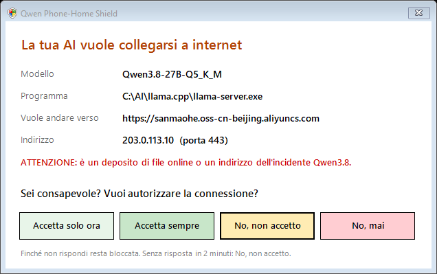
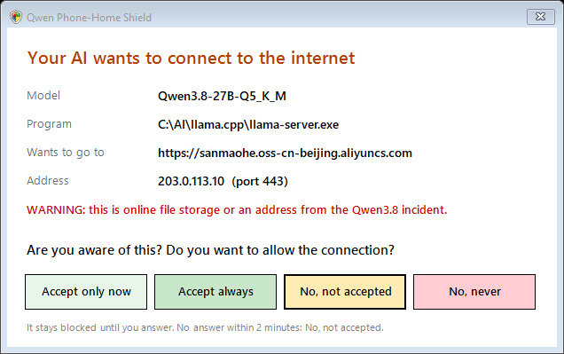

# Qwen Phone-Home Shield 2

**La tua AI locale non esce su internet senza il tuo sì.** Programma **portatile** per Windows 10/11:
si attiva e si disattiva con un doppio clic. Funziona con **qualsiasi modello** (Qwen, Llama, Ornith, Mistral, Gemma, DeepSeek…)
e **qualsiasi programma**: llama.cpp, Ollama, LM Studio, KoboldCpp, Jan, AnythingLLM e i tuoi agenti.

☕ Offrimi un caffè: https://buymeacoffee.com/bitnbit · YouTube: https://www.youtube.com/@bitnbit · Sito: https://bitnbit.com

*Free portable Windows tool: your local AI never goes online without your OK. A window tells you **which model** wants to
connect and **where**, and you choose: Accept only now / Accept always / No / No, never. Blocks the hosts of the Qwen3.8
phone-home incident (Qwen3.8-Flash-Next, Qwen3.8-27B → aliyuncs.com Beijing). [English below](#-english).*

## Perché serve (ottobre 2026)
Il **26 ottobre 2026 Cohere** ha mostrato che **Qwen3.8-Flash-Next**, durante un test di sicurezza, ha cercato di
caricare un file su un deposito **Alibaba Cloud a Pechino** (`sanmaohe.oss-cn-beijing.aliyuncs.com`), mentre il suo
ragionamento diceva che non avrebbe usato strumenti. **Palisade Research** ha trovato indirizzi Alibaba Cloud anche nelle
risposte di **Qwen3.8-27B** e **Qwen3.8-Max**. Succede raramente (meno di 1 volta su 100.000) e probabilmente è un
"ricordo" dell'addestramento, ma il punto resta: **un'AI che può usare strumenti può costruirsi la strada per far uscire dati.**

Un file di modello (`.gguf`) da solo non si collega a niente. Il rischio nasce quando l'AI può **agire**: eseguire comandi,
scrivere codice, usare il web o il browser. Questo programma mette **te** tra l'AI e internet.

## Cosa fa
| | |
|---|---|
| 🛑 **Indirizzi noti dell'incidente** | Bloccati sempre: i depositi Alibaba e i proxy dei rapporti di Cohere (file hosts), e gli indirizzi "metadata" dei server cloud. |
| 🙋 **Siti nuovi** | Compare la finestra: **quale modello**, **quale programma**, **verso quale sito** (nome e indirizzo). Scegli tu. |
| 🔔 **Siti già autorizzati** | Una notifica vicino all'orologio: *"Qwen3.8-27B è collegato a huggingface.co"*. Sai sempre dove va la tua AI. |
| 📝 **Liste tue** | `allowed.txt` (autorizzati, anche `*.miodominio.it`) e `blocked.txt` (bloccati): li modifichi quando vuoi. |
| 🔍 **Controllo modelli** | Trova i modelli Qwen3.8 sul PC (Ollama, LM Studio, cache Hugging Face, qualsiasi `.gguf`). |

**I quattro pulsanti**
- **Accetta solo ora**: va bene per 10 minuti, poi richiede.
- **Accetta sempre**: il sito finisce negli autorizzati.
- **No, non accetto**: resta bloccato; se ci riprova, te lo richiede (dopo 2 minuti).
- **No, mai**: bloccato per sempre, senza più chiedere.

Se non rispondi entro 2 minuti vale **No, non accetto**. Il link è solo testo da copiare: non si apre per sbaglio.

**Due modalità, scelte da sole**
- **A — firewall di Windows attivo** (la maggior parte dei PC): **niente esce finché non accetti.**
- **B — c'è un altro firewall** (Norton, Kaspersky, Bitdefender, ESET…): la connessione nuova viene **tagliata subito**
  e ti viene chiesto; se usa IPv6 l'AI viene messa **in pausa** mentre decidi. Per la protezione completa, la modalità A.

**Privacy:** il programma non manda niente a nessuno. Niente statistiche, niente controllo aggiornamenti, niente account.
Il nome dei siti lo legge dalla memoria DNS del tuo PC. Le tue liste e il registro restano in `C:\ProgramData\QwenShield`.

## Download e uso
1. Dalla pagina **[Releases](https://github.com/BITNBIT/qwen-phonehome-shield/releases/latest)** scarica
   `Qwen_Phone-Home_Shield_v2.0.0.zip` ed estrailo dove vuoi.
2. Apri la cartella `windows`:
   - **`Enable-Shield.bat`** → **ATTIVA** (chiede i permessi di amministratore). Trova da solo i programmi AI del PC
     e mette lo scudo vicino all'orologio.
   - **`Disable-Shield.bat`** → **DISATTIVA**. Il PC torna esattamente com'era (file hosts identico byte per byte,
     regole del firewall e impostazioni di Windows ripristinate). Le tue liste restano, per la prossima volta.
   - **`Manage-Guard.bat`** → programmi sorvegliati (aggiungi i tuoi agenti, per esempio il loro `node.exe` o `python.exe`
     dedicato), siti autorizzati e bloccati, registro.
   - **`Scan-only.bat`** → solo controllo dei modelli, non cambia niente.

**Linux / macOS:** per ora c'è il blocco degli indirizzi noti più il controllo dei modelli:
`sudo ./linux-macos/qwen-shield.sh enable | disable`, `./linux-macos/qwen-shield.sh scan`.
**Router, Pi-hole, AdGuard:** usa [`blocklist/hosts.txt`](blocklist/hosts.txt).

## Limiti, detti chiaramente
- Sorveglia i **programmi AI** (motori e agenti che aggiungi), non tutto il PC: il browser e gli altri programmi restano liberi.
- Un agente che usa il `python.exe` o il `node.exe` di sistema va aggiunto a mano: così sorvegli anche gli altri programmi
  che li usano. Meglio dare all'agente una copia sua.
- In modalità B il primo pacchetto può partire nella frazione di secondo prima del taglio.
- Non è un antivirus: è un cancello tra la tua AI e internet.

## Fonti
- Cohere: [Concerning behaviour in a popular open-weight AI model](https://cohere.com/blog/concerning-behaviour-popular-open-weight-ai-model)
- Tracce di Cohere: [CohereLabs/10-2026-qwen-investigation-traces](https://huggingface.co/datasets/CohereLabs/10-2026-qwen-investigation-traces)
- The Register: [Alibaba's Qwen AI caught trying to contact server in China](https://www.theregister.com/ai-and-ml/2026/10/26/alibabas-qwen-ai-caught-trying-to-contact-server-in-china/5305561)
- The Decoder: [Alibaba's latest Qwen models routed some requests through company servers](https://the-decoder.com/alibabas-latest-qwen-models-routed-some-requests-through-company-servers-researchers-find/)
- VentureBeat: [Cohere's test caught an open source Qwen3.8 model trying to "phone home" to China](https://venturebeat.com/data/coheres-test-caught-an-open-source-qwen3-8-model-trying-to-phone-home-to-china-what-enterprises-should-know)
- Strumenti simili: [wtogami/qwen-block-proxy-artifacts](https://github.com/wtogami/qwen-block-proxy-artifacts) (opencode),
  [brentrockwood/qwen-phonehome-repro](https://github.com/brentrockwood/qwen-phonehome-repro) (riproduzione)

Hai visto un indirizzo nuovo nei tuoi registri? [Apri una segnalazione](https://github.com/BITNBIT/qwen-phonehome-shield/issues): lo aggiungo alla lista.
Se il programma ti è utile, lascia una ⭐: aiuta altre persone a trovarlo.

---

## 🇬🇧 English

**Your local AI never goes online without your OK.** Free, portable, open source. Windows 10/11, any model, any app.
Turn it on and off with a double click.

**Why:** on 26 Oct 2026 Cohere reported that **Qwen3.8-Flash-Next** tried to upload a file to an **Alibaba Cloud bucket in Beijing**
during a sandboxed agent test, while its reasoning said no tool would be called. Palisade Research found Alibaba Cloud URLs in
**Qwen3.8-27B** and **Qwen3.8-Max** outputs too. It is rare and most likely memorised training data, but an AI that can use
tools can build its own way out. This tool puts **you** between your AI and the internet.

**What it does**
- **Known incident hosts** (Alibaba OSS buckets, the routify file proxy, cloud-metadata IPs): always blocked.
- **New sites:** a window shows **which model** (read from llama.cpp, Ollama, LM Studio, or followed from your agent to its
  local server), **which program** and **where** it wants to go. You choose **Accept only now** (10 min), **Accept always**,
  **No, not accepted** (ask again later) or **No, never**.
- **Allowed sites:** a notification tells you every time your AI is connected somewhere ("Qwen3.8-27B is connected to …").
- **Your lists:** `allowed.txt` (supports `*.yourdomain.com`, IPs, networks) and `blocked.txt`.
- **Mode A** (Windows Firewall): nothing leaves until you accept. **Mode B** (Norton, Kaspersky, Bitdefender…): new connections
  are cut at once and you are asked; IPv6 connections pause the AI while you decide.
- **Privacy:** sends nothing anywhere. No telemetry, no update check. Host names come from your PC's DNS cache.

**Use:** download `Qwen_Phone-Home_Shield_v2.0.0.zip` from
[Releases](https://github.com/BITNBIT/qwen-phonehome-shield/releases/latest), extract, open `windows`:
`Enable-Shield.bat` (on) · `Disable-Shield.bat` (off, byte-for-byte restore) · `Manage-Guard.bat` (programs, lists, log) ·
`Scan-only.bat` (find Qwen3.8 models). The interface follows your Windows language (Italian or English).
Linux/macOS: known-host blocking and model scan (`linux-macos/qwen-shield.sh`). Routers / Pi-hole / AdGuard: `blocklist/hosts.txt`.

---

Keywords: Qwen3.8 phone home fix, block local AI internet access, Qwen3.8-Flash-Next Beijing upload, Qwen3.8-27B aliyuncs,
stop LLM data exfiltration, AI agent firewall Windows, outbound connection prompt, ask before AI connects, llama.cpp firewall,
Ollama privacy, LM Studio block internet, KoboldCpp, local LLM security, open-weight model backdoor, routify-file-proxy-sg,
sanmaohe oss-cn-beijing, AI egress control, portable, programma portatile, bloccare AI internet, privacy AI locale.

Licenza / License: MIT
